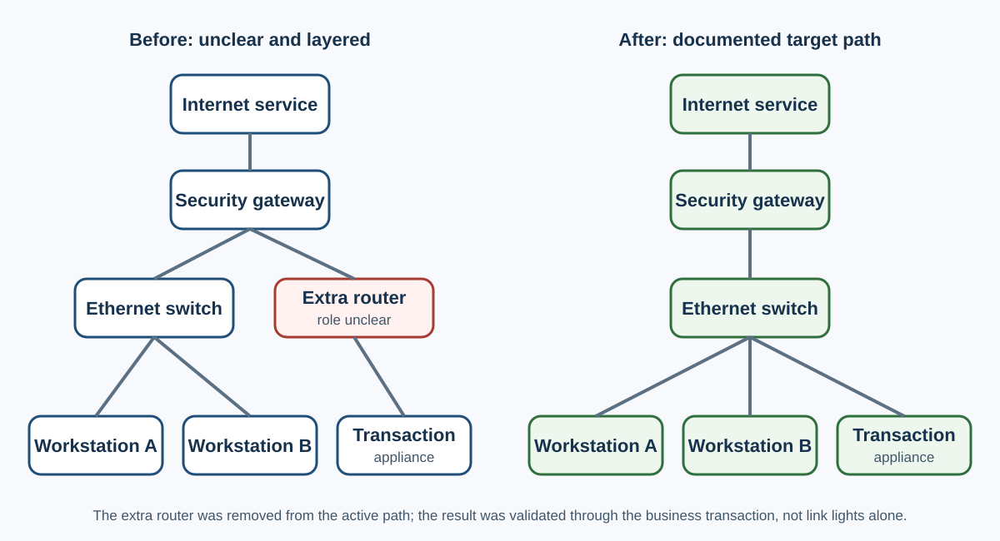

# Anonymized Network Connectivity Incident

## Context

This is a sanitized reconstruction of a real support method. Names, locations, device labels, port numbers, hostnames, scripts, addresses, ticket references, and internal systems were removed or generalized.

A remote site reported that internet-dependent transactions remained unavailable after an earlier recovery attempt. Two workstations and a transaction appliance depended on a security gateway and a small local switching path. An additional consumer router was also present.



## Observation

- The user reported that internet access was still unavailable.
- Cabling documentation was incomplete.
- The security gateway, an Ethernet switch, a consumer router, two workstations, and a transaction appliance were connected through an unclear path.
- A device could appear online while the business transaction still failed.

## Problem statement

The immediate problem was not simply "internet down." The support task was to identify the actual physical path, remove an unnecessary routing layer, restore the expected topology, and verify the business transaction from both workstations.

## Controlled troubleshooting

### 1. Map before changing

The user traced one cable at a time while support recorded the device role, connected device, cable color as a temporary visual aid, and current port. Unknown connections remained labeled unknown instead of being guessed.

### 2. Establish a safer target topology

The intended path was simplified to:

```text
Internet service -> security gateway -> Ethernet switch -> endpoints
```

The consumer router was not required in the target path. Removing it reduced the chance of double NAT, competing DHCP service, or an unexpected subnet. Those were plausible risks, not a confirmed root cause.

### 3. Change one layer at a time

With the user present and business activity paused:

1. Power was removed from the affected network devices.
2. Endpoint connections were moved from the consumer router to the switch.
3. The transaction appliance was connected to the intended gateway path.
4. The consumer router remained disconnected.
5. Devices were powered on in order: upstream service, gateway, switch, then endpoints.

Each step was documented before continuing.

### 4. Validate beyond link state

Support confirmed:

- Gateway and switch link state
- Transaction appliance connectivity
- Workstation network access
- The business transaction from workstation A
- The business transaction from workstation B

Both workstation transactions completed successfully after the topology was simplified.

## Result

The required workflow was restored on both workstations. The consumer router remained out of the production path. The documented outcome was "service restored after topology correction and ordered restart," not a stronger root-cause claim that the evidence could not prove.

## Rollback and follow-up

- Before-change connections were recorded so the site could be restored if the new path failed.
- Unknown cabling remained a follow-up item for physical labeling.
- The final port map and device inventory required validation by the network owner.
- A future change should use approved topology documentation and configuration backups rather than relying on cable color alone.

## What this demonstrates

- Remote physical-layer coordination
- Clear distinction between observation and inference
- Topology mapping before change
- Removal of unnecessary complexity
- Ordered recovery
- Validation of the actual business workflow
- Conservative root-cause wording

## Reusable validation rule

Do not close a connectivity ticket because lights are on, a device replies to ping, or a portal shows online. Close it after the user’s original application workflow succeeds and the result remains stable.
