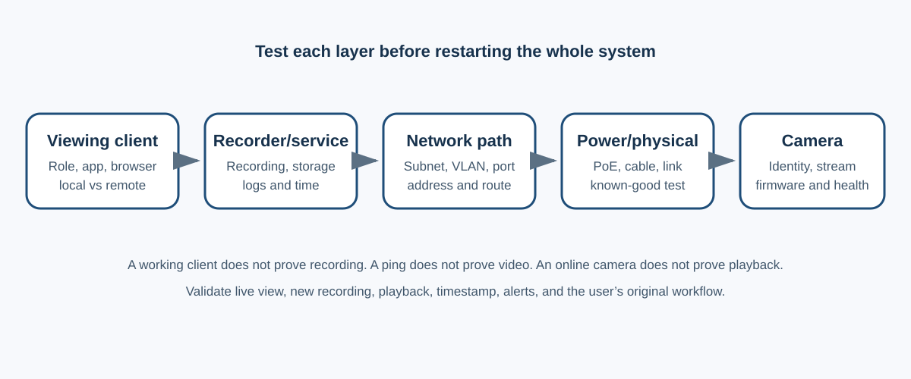

# Network Camera and Recording-System Troubleshooting

## Purpose

Use this runbook to isolate an unavailable camera or recording view across five layers: viewing client, recorder or video-management service, network path, power, and camera. The steps are vendor-neutral, with public vendor references used only for technical support.

## Safety, privacy, and authority

- Video systems may contain sensitive personal and security information. Use the least access required.
- Do not export footage, change retention, remove a camera, reset a device, update firmware, or alter credentials without authorization.
- Preserve time synchronization, audit logs, retention, and evidence-handling requirements.
- Avoid power cycling a recorder during an active export, update, disk rebuild, investigation, or critical recording window.
- Do not expose camera or recorder interfaces directly to the public internet.

## 1. Define scope and impact

Record:

- One camera, a camera group, one recorder, one site, or multiple sites affected
- Live view, playback, recording, export, remote access, or alerting affected
- First-known time and last-known good time
- Exact client error and whether the camera is listed as offline, unauthorized, unavailable, or recording-disabled
- Whether local recorder access and remote/cloud access differ

## 2. Separate viewing-client failure from system failure

1. Check the approved service-status page.
2. Test another approved client or local recorder console.
3. Compare live view and recorded playback.
4. Confirm the user has the required role and site assignment.

If another client works, focus on the first client, browser, version, cache, route, or account. Do not reboot the recorder for a single-client symptom without broader evidence.

## 3. Check recorder and recording health

- Confirm the recorder or service is online.
- Review storage, recording, licensing, time, and update status.
- Review system logs for camera disconnects, abrupt power loss, network-interface changes, or repeated restarts.
- Confirm the recorder’s camera-facing adapter and management-facing adapter are in their expected roles.

Use a controlled restart only when approved and when storage, update, and recording conditions are safe. Capture health and logs first.

## 4. Check power and physical path

- Confirm the camera receives power from the approved source.
- Check PoE switch or injector state, cable seating, link indicators, and port errors.
- If authorized, test a known-good cable and known-good PoE port one variable at a time.
- Do not connect two power sources unless the manufacturer explicitly supports it.

## 5. Check network identity and reachability

- Confirm camera and recorder interfaces are in the expected subnet or routed design.
- Check for duplicate addresses, unexpected DHCP fallback, wrong VLAN, or changed switch port.
- Test reachability from the recorder or approved management host.
- Remember that a ping result alone does not prove video transport, authentication, or recording works.
- Confirm the required protocol and port through approved tools.

OpenEye’s public guidance notes that the camera and recorder path must share appropriate network reachability, that duplicate addresses can prevent communication, and that a known-good cable test can isolate physical faults.

## 6. Check camera and integration state

- Confirm the camera is enabled, has the expected address, and reports healthy time and firmware state.
- Confirm credentials through the approved credential-management process. Never place them in the ticket.
- For third-party integrations, confirm the approved protocol or ONVIF settings and compatibility.
- Confirm stream profile, codec, resolution, frame rate, and bandwidth are supported by the recorder and network.

## 7. Controlled recovery

Use the least disruptive approved action:

1. Refresh or reconnect the viewing client.
2. Restart the affected client service.
3. Re-seat or replace one cable.
4. Move one camera to a known-good port.
5. Restart one camera.
6. Restart the recorder only with approval and impact review.
7. Update software or firmware only with compatibility review, backup, maintenance window, and rollback plan.

Factory reset and camera removal are last-resort changes. Export configuration, record addressing and stream settings, preserve evidence, and obtain explicit approval first.

## Validation

Confirm:

- Live view remains stable for an observation period.
- New recording exists after recovery.
- Playback crosses the recovery time.
- Timestamps and time zone are correct.
- Remote and local views work as required.
- Alerts, retention, and exports behave normally.
- The user confirms the original workflow.

## Escalation package

Provide the sanitized device role, model, firmware, recorder version, timestamps, scope, error, physical and network tests, log findings, changes, rollback status, and whether recording or only viewing is affected.

## Authoritative references

- [OpenEye: How to tell if a recorder is communicating with a camera](https://answers.openeye.net/Troubleshooting/Troubleshooting_Guides/How_to_tell_if_your_recorder_is_communicating_with_a_camera)
- [OpenEye: Why do my cameras not connect?](https://answers.openeye.net/Troubleshooting/Troubleshooting_Guides/Why_Do_My_Cameras_Not_Connect%3F)
- [OpenEye: System logs](https://answers.openeye.net/Troubleshooting/Troubleshooting_Guides/System_Logs)
- [Axis: Network connection troubleshooting](https://help.axis.com/en-us/troubleshooting-network)
