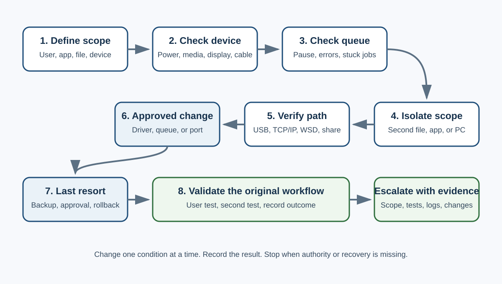

# Windows Printer Troubleshooting

## Purpose

Use this runbook to isolate a Windows printing issue without making unnecessary or irreversible changes. It applies to local USB printers, network printers, and shared printers. Managed print servers and restricted endpoints may require administrator or infrastructure-team involvement.



## Safety and authority

- Confirm the user can pause printing and save open work.
- Do not install unapproved software or drivers.
- Do not change a production printer address, server queue, VLAN, or firewall rule without authorization.
- Treat firmware updates, driver removal, printer removal, and factory reset as controlled changes.
- Capture the current printer name, connection type, port, driver, queue, and configuration before a change.
- Keep a rollback path. A factory reset is a last resort and may erase network, scan, address-book, and security settings.

## 1. Define the symptom and scope

Record:

- What action fails: print, scan, copy, discovery, authentication, or finishing option.
- Exact error text and time.
- Whether one document, one application, one user, one workstation, or every user is affected.
- Whether another printer works from the same workstation.
- Whether the device display shows paper, toner, cover, jam, sleep, offline, or network errors.

Test a simple one-page document from a second application. This separates document or application failure from a Windows, driver, connectivity, or device problem.

## 2. Confirm the target printer and physical state

1. Confirm the selected queue matches the intended physical device.
2. Check paper, consumables, covers, jams, and the device display.
3. Confirm USB or network cabling is seated and link indicators are present where applicable.
4. For Wi-Fi, confirm the printer is connected to the intended network.
5. Print a device configuration or status page if permitted.

**Pass condition:** the device is ready and the selected queue points to that device.

## 3. Review the Windows queue

1. Open **Settings > Bluetooth & devices > Printers & scanners**.
2. Select the printer and open its queue.
3. Note paused, error, or stuck jobs.
4. Confirm with the user before canceling jobs because unsaved print output cannot be recovered from the queue.
5. Submit one controlled test page.

If the queue cannot clear normally, an administrator may restart the Print Spooler service under the organization’s change policy:

```powershell
Restart-Service -Name Spooler
```

Do not manually delete spool files unless normal queue clearing and an approved spooler restart fail. Record any destructive queue action.

## 4. Isolate application, user, and workstation scope

- Print a new plain-text document from another application.
- Test the same document type with another known-good file.
- If policy permits, test another user profile or another managed workstation.
- Do not use an administrator profile as a general workaround. Use it only as an authorized isolation test and avoid accessing the user’s private files.

**Interpretation:**

- One file fails: inspect the file, font, image, or application.
- One application fails: repair or update that application before changing the printer.
- One Windows profile fails: investigate profile-level settings and permissions.
- Every workstation fails: focus on the printer, print server, network path, or shared configuration.

## 5. Identify the connection and port correctly

- A USB printer uses a local USB port such as `USB001`.
- A network printer may use a Standard TCP/IP port, WSD discovery, a shared server queue, or a vendor-managed connector.
- WSD is a network device-discovery and print path. It is not the same as USB.

Record the existing port before changing it. If a stable, approved address is available and policy supports it, a Standard TCP/IP port may be used for a network printer. Coordinate address reservations with the network owner to prevent conflicts.

## 6. Test network reachability without overclaiming

1. Confirm the workstation has general network access.
2. Compare the printer status page with the approved inventory or DHCP record.
3. Test the printer’s management page or approved print port if allowed.
4. Remember that a successful ping does not prove the print service works, and a failed ping does not prove the device is offline because ICMP may be blocked.
5. Check for duplicate-address alerts, wrong subnet, bad cabling, disabled switch ports, or power problems through the authorized network tools.

Escalate to the network or print-service owner with timestamps, source, destination, port or protocol tested, and observed result.

## 7. Use current Windows and vendor diagnostics

- Run the Windows printer troubleshooter in **Get Help**.
- Check Windows Update under the organization’s patch policy.
- Use only the printer manufacturer’s official support site for approved drivers and firmware.
- Match the driver to the exact model, architecture, and connection method.
- If using a managed print server, verify the approved queue and packaged driver before local installation.

## 8. Controlled reinstall or reconfiguration

Before removing anything, record:

- Queue name and sharing path
- Port name and address
- Driver name and version
- Duplex, tray, color, finishing, and security settings
- Scan destinations or address-book dependencies

Remove and reinstall only the affected queue or driver unless broader removal is approved. Do not uninstall unrelated drivers simply because they are from another manufacturer.

## 9. Last-resort device reset

A factory reset requires approval, a configuration backup when available, a maintenance window, and a tested reconfiguration plan. After reset, restore only the required network and security settings, then validate print, scan, monitoring, and user access.

## Validation and closure

Validate the original workflow:

- The user prints the original document from the original application.
- At least one second test confirms the result persists.
- The correct queue, port, driver, and device state are recorded.
- Monitoring or shared access is restored.
- The user confirms the issue is resolved.

Document the symptom, scope, evidence, changes, outcome, rollback status, and any follow-up owner.

## Escalation package

Provide:

- Device model and asset identifier, sanitized when public
- Connection type and queue/port type
- Exact error and timestamps
- Scope of impact
- Tests performed and results
- Driver and firmware versions
- Relevant event logs or spooler errors
- Change and rollback history

## Authoritative references

- [Microsoft: Fix printer connection and printing problems in Windows](https://support.microsoft.com/en-us/windows/hardware/printer/fix-printer-connection-and-printing-problems-in-windows)
- [Microsoft Learn: Printer is not responding](https://learn.microsoft.com/en-us/troubleshoot/windows-server/printing/printer-not-responding)
- [Microsoft: Troubleshoot printing problems in Microsoft 365 apps](https://support.microsoft.com/en-us/office/troubleshoot-printing-problems-in-microsoft-365-apps)
